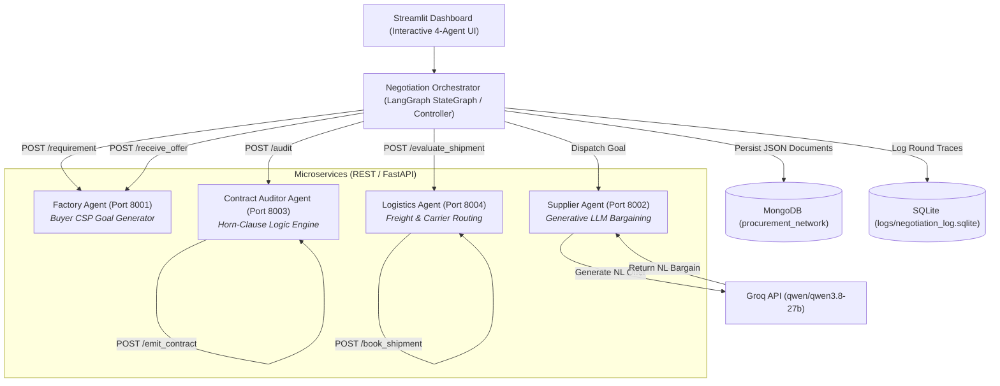

# Self-Negotiating Procurement Network

[](https://www.python.org/)
[](https://fastapi.tiangolo.com/)
[](https://groq.com/)
[](https://langchain-ai.github.io/langgraph/)
[](https://www.mongodb.com/)
[](https://streamlit.io/)

**A 4-Agent, Horn-Clause-Audited & Logistics-Certified Autonomous Procurement Ecosystem**

---

## 1. Executive Summary & Problem Statement

Modern procurement in manufacturing is a partially observable, adversarial, multi-stakeholder challenge:
- **Factory Agent**: Needs raw materials under strict price ceilings and delivery deadlines.
- **Supplier Agent**: Manages private inventory and shifting margin pressures that it will not disclose.
- **Logistics & Freight Agent**: Must verify transit times, carrier capacities, and shipping costs to ensure deliveries meet physical deadlines.
- **Contract Auditor Agent**: Evaluates every deal against formal Horn-clause logic rules to prevent hallucinated or invalid commitments.

**The Solution**: This architecture fuses generative natural-language bargaining (Groq LLM) with symbolic Horn-clause validation, real-time freight route optimization, and dual-layer persistence (MongoDB Document Store + SQLite).

Every offer exchanged is:
1. **Linguistically natural**: Generated through the Groq LLM (`qwen/qwen3.8-27b`).
2. **Logically certified**: Proven by a first-order Horn-clause inference engine.
3. **Logistics-verified**: Physically routed via verified freight carriers (Same-Day Cargo, Air Express, Road, Rail).
4. **Audit-trailed**: Persisted into MongoDB (`procurement_network`) and SQLite.

---

## 2. System Architecture



---

## 3. The Four Agents & PEAS Formulation

| Agent | Performance Measure | Environment | Actuators | Sensors | Agent Type |
| :--- | :--- | :--- | :--- | :--- | :--- |
| **Factory Agent** (Port 8001) | Deal secured within budget ceiling & deadline; rounds minimised; zero constraint violations accepted | Multi-agent procurement; partially observable; stochastic price shocks | `send_requirement()`, `receive_offer()`, `accept_offer()`, `reject_offer()`, `abort()` | Incoming offers; round counter; shock alert broadcast | **Model-based reflex agent** |
| **Supplier Agent** (Port 8002) | Profit margin per unit; deal acceptance rate; low Horn-clause rejections | Partially observable (private inventory & cost floor); price volatility | `generate_offer()` [Groq LLM], `revise_offer()`, `apply_shock()` | Requirement message; auditor rejection feedback; logistics delay feedback | **Utility-based (generative) agent** |
| **Contract Auditor Agent** (Port 8003) | 100% correct VALID/REJECTED verdicts; zero false accepts; sub-millisecond inference | Fully observable w.r.t declared facts; neutral arbitrator | `audit()`, `emit_verdict()`, `emit_violated_clauses()`, `emit_contract()` | Factory constraints; Supplier offer facts (parsed from NL) | **Pure Logic / Knowledge-based agent** |
| **Logistics Agent** (Port 8004) | Fulfillment feasibility (`lead_time + transit ≤ deadline`); minimum freight rate; lowest $CO_2$ impact | Carrier fleet schedule; transit constraints; shipment capacities | `evaluate_shipment()`, `select_carrier()`, `book_shipment()`, `emit_manifest()` | Item type, quantity, supplier lead time, factory delivery deadline | **Utility-based Optimization & Route Verification agent** |

---

## 4. Horn-Clause Knowledge Base

The Auditor Agent executes a pure-Python forward-chaining Horn-clause inference engine:

```prolog
valid_price       ← offer_price ≤ factory_max_price
valid_delivery    ← offer_lead_time ≤ factory_deadline
valid_quantity    ← offer_qty ≥ factory_min_qty
suspicious_offer  ← pricing_pressure = high ∧ offer_price < cost_floor
contract_valid    ← valid_price ∧ valid_delivery ∧ valid_quantity ∧ ¬suspicious_offer
```

If `contract_valid` fails, unsatisfied clauses are returned as structured feedback to prompt the Supplier's LLM toward target concessions (Hill-Climbing Local Search).

---

## 5. Project Layout

```
foai-assignment/
├── factory_agent.py          # Agent 1 — CSP service (port 8001)
├── supplier_agent.py         # Agent 2 — Groq LLM bargaining service (port 8002)
├── auditor_agent.py          # Agent 3 — Horn-clause engine (port 8003)
├── logistics_agent.py        # Agent 4 — Freight & carrier routing service (port 8004)
├── mongo_store.py            # MongoDB persistence & resilient JSON fallback layer
├── langgraph_controller.py   # LangGraph cyclic StateGraph multi-agent orchestrator
├── negotiation_controller.py # Multi-scenario orchestrator & price-shock runner
├── rules/
│   └── horn_rules.py         # Externalised Horn-clause rule base
├── dashboard.py              # Streamlit interactive dashboard with dynamic 4-agent answer cards
├── config.yaml               # Central configuration (constraints, LLM model, shock multipliers)
├── analysis/
│   └── plot_speed.py         # Post-hoc trace analysis & plot generator
├── tests/
│   ├── test_horn_engine.py       # Unit tests for Horn-clause engine
│   ├── test_logistics_and_graph.py # Unit tests for Logistics Agent, MongoStore & LangGraph
│   └── test_integration.py       # Scenario integration tests
├── logs/
│   ├── negotiation_log.sqlite    # SQLite historical round log
│   └── mongo_audit_store.json    # Local JSON document store fallback (if Mongo offline)
├── .env                      # GROQ_API_KEY (pre-configured)
├── requirements.txt
└── README.md
```

---

## 6. Setup & Execution Guide

> **Requirements:** Python 3.9+ (tested on Python 3.14). No virtual environment required.

### Step 1: Install Dependencies

```powershell
pip install -r requirements.txt
```

> **Note:** Dependencies use `>=` version specifications so pre-compiled wheels are installed automatically for your Python version without needing a C/C++ compiler.

---

### Step 2: Groq API Key & MongoDB Configuration

* **Groq API**: Pre-configured in `.env` and as a fallback inside `supplier_agent.py`.
* **Active LLM Model**: `qwen/qwen3.8-27b` (configured in `config.yaml`):
  ```yaml
  groq:
    model: "qwen/qwen3.8-27b"
    temperature: 0.4
    max_tokens: 512
  ```
* **MongoDB**: Automatically connects to local MongoDB at `mongodb://localhost:27017` (database `procurement_network`) or Atlas via `MONGO_URI` in `.env`. If MongoDB is offline, it automatically switches to local JSON fallback mode without crashing.

---

### Step 3: Launch the 4 Microservices

Open **4 separate terminal windows** and launch one agent per terminal:

```powershell
# Terminal 1 — Factory Agent (Port 8001)
python -m uvicorn factory_agent:app --port 8001

# Terminal 2 — Supplier Agent (Port 8002)
python -m uvicorn supplier_agent:app --port 8002

# Terminal 3 — Auditor Agent (Port 8003)
python -m uvicorn auditor_agent:app --port 8003

# Terminal 4 — Logistics Agent (Port 8004)
python -m uvicorn logistics_agent:app --port 8004
```

Wait until `Application startup complete.` appears in all 4 terminals.

---

### Step 4: Launch the Streamlit Dashboard (Interactive UI)

Open a **5th terminal** and run:

```powershell
python -m streamlit run dashboard.py
```

Open **http://localhost:8501** (or the port displayed in terminal, e.g. `8502`/`8503`) in your browser.

#### 🎛️ Dashboard Highlights:
1. **Dynamic 4-Agent Cards**:
   - **Initial Load**: Displays the default `/state` for all 4 microservices.
   - **On Every Search ("🚀 Run Live 4-Agent Negotiation")**: The cards **dynamically update** to show the generated answers for each of the 4 ports for that specific deal:
     - **Factory (8001)**: Requested item, quantity, max budget, agreed price, rounds, decision (`ACCEPTED`/`FAILED`).
     - **Supplier (8002)**: Offered price, quantity, lead time, Groq natural-language bargain text, pricing pressure.
     - **Auditor (8003)**: Formal Horn verdict (`VALID`/`REJECTED`), satisfied rules, violated clauses, contract certification.
     - **Logistics (8004)**: Route feasibility, selected carrier (Same-Day Direct Cargo, Air Express, Road, Rail), transit days, freight cost, carbon emissions, booking manifest ID.
2. **MongoDB Live Document Store Tab**: Inspect live JSON documents saved in the `contracts` and `negotiation_sessions` collections directly from MongoDB.
3. **Round-by-Round Step Trace**: Interactive expanders showing natural-language offers, Horn deductions, and carrier route verifications.

---

### Step 5: Run Negotiation via CLI

You can also run automated episodes directly from the command line:

#### A. Standard Orchestrator (`negotiation_controller.py`):
```powershell
# Single scenario
python negotiation_controller.py --scenario baseline
python negotiation_controller.py --scenario clash
python negotiation_controller.py --scenario shock
python negotiation_controller.py --scenario lowball
python negotiation_controller.py --scenario stress

# Run all 5 scenarios sequentially
python negotiation_controller.py --scenario all
```

#### B. Advanced LangGraph Cyclic State Machine (`langgraph_controller.py`):
```powershell
# View compiled LangGraph Mermaid flowchart
python langgraph_controller.py --mermaid

# Run baseline through LangGraph
python langgraph_controller.py --scenario baseline

# Run all scenarios through LangGraph
python langgraph_controller.py --scenario all
```

---

### Step 6: Generate Post-Hoc Analysis Plots

```powershell
python analysis/plot_speed.py
```

Plots are saved to `analysis/plots/`.

---

## 7. Demo Scenarios & Observed Benchmark Results

| Scenario | CLI Flag | Setup | Expected Behaviour | Observed Result |
| :--- | :--- | :--- | :--- | :--- |
| **Baseline Agreement** | `baseline` | Ample inventory, low pressure | Agrees within 1–2 rounds with verified freight | ✅ SUCCESS — Agreed @ $84.00–$85.00 |
| **Hard Constraint Clash** | `clash` | Factory ceiling ($50) below Supplier cost floor ($60) | Exhausts round limit → FAILED | ✅ FAILED after 6 rounds (Impasse proven) |
| **Price Shock Mid-Negotiation** | `shock` | Market shock triggered at round 3 | Supplier cost floor jumps 25% | ✅ SUCCESS — Re-converges with revised terms |
| **Suspicious Lowball Offer** | `lowball` | Below-cost offer under high pressure | Auditor flags `suspicious_offer`, round 1 rejected | ✅ SUCCESS — Auditor forces safe renegotiation |
| **Stress Test** | `stress` | Extreme ceiling ($1) and 1-day deadline | Halts gracefully at `ROUND_LIMIT` | ✅ Handled gracefully within constraints |

---

## 8. MongoDB Document Collections

All multilateral negotiation traces are stored in MongoDB under database `procurement_network`:

1. **`contracts`**: Certified multilateral contracts:
   ```json
   {
     "session_id": "4b6784bf",
     "scenario": "baseline",
     "status": "SUCCESS",
     "final_price": 85.0,
     "final_qty": 500,
     "final_lead_time": 7,
     "logistics_booking": {
       "booking_id": "BK-4B6784BF-SAM",
       "carrier_name": "Local Hub Direct Dispatch",
       "transit_days": 0,
       "freight_cost_per_unit": 2.2,
       "total_freight_cost": 1100.0,
       "status": "CONFIRMED"
     },
     "orchestrator": "LangGraph",
     "finalized_at": "2026-10-12T14:56:41Z"
   }
   ```
2. **`negotiation_sessions`**: Full session records with nested round traces.
3. **`logistics_shipments`**: Freight route evaluations, carrier options, and bookings.
4. **`audit_traces`**: Horn-clause verification facts and rule deductions.

To inspect in Mongo shell:
```powershell
mongosh
use procurement_network
db.contracts.find().pretty()
```

---

## 9. Running Tests

```powershell
# 1. Horn-clause engine unit tests (no microservices needed)
python -m pytest tests/test_horn_engine.py -v

# 2. Logistics Agent, MongoStore & LangGraph unit tests
python -m pytest tests/test_logistics_and_graph.py -v

# 3. Full integration tests (all microservices running)
python -m pytest tests/test_integration.py -v
```
